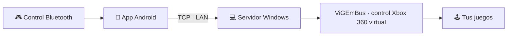

<div align="center">

# Bluetooth receptor on LAN

**Convierte cualquier teléfono Android en un receptor de control inalámbrico de baja latencia para tu PC con Windows.**

[](https://github.com/RobiiAragon/Bluetooth-receptor-onLAN/actions/workflows/ci.yml)     

[English](README.md) · **Español**

</div>

---

¿Tu PC no tiene Bluetooth? Empareja el control con tu teléfono. La app de Android captura el control y manda **solo el estado de los botones** por tu red local; el servidor de Windows lo convierte en un **control virtual de Xbox 360** (XInput) con ViGEm, así cualquier juego lo ve como un control normal.



## Funciones

- ⚡ Transmisión TCP de baja latencia con keepalive.
- 🔎 Descubrimiento automático o `IP:puerto` manual.
- 🔋 Funciona en segundo plano como servicio con un overlay mínimo; ajustes opcionales de batería y Wi-Fi.
- 🪟 App de bandeja en Windows con ventana de log.
- 🛟 A prueba de fallos: si el teléfono deja de enviar datos 8 s (se cae el Wi-Fi, se duerme) el servidor suelta todos los botones y sticks, así nada se queda presionado en el juego.

## Requisitos

- Android 7.0+ (probado en Android 10–15) con un control Bluetooth emparejado (probado con Xbox One)
- Windows 10/11 con el [driver ViGEmBus](https://vigembusdriver.com/)
- Ambos en la misma red · puerto TCP **39500** (y UDP **39501** para el descubrimiento automático) permitidos en el Firewall de Windows

## Compilar

```powershell
git clone https://github.com/RobiiAragon/Bluetooth-receptor-onLAN.git
cd Bluetooth-receptor-onLAN
./build-pc.ps1            # servidor de Windows → ./publishWin
./build-android.ps1       # APK de Android (usa el Gradle wrapper)
./build-android-adb.ps1   # compila e instala por adb
```

Necesitas el [.NET 8 SDK](https://dotnet.microsoft.com/download) y el Android SDK (lo instala Android Studio) con JDK 17.

¿Sin herramientas? Cada ejecución del CI publica un **APK** de debug y el **.exe del servidor de Windows** como artifacts descargables (Actions → última ejecución → Artifacts).

### Pruebas

```sh
dotnet test pc-server.Tests                    # protocolo (corre en cualquier sistema)
cd android-app && ./gradlew testDebugUnitTest  # mapeo de botones
```

## Uso

1. Instala ViGEmBus y abre el servidor en la PC (puerto `39500` por defecto).
2. Abre la app en Android, elige tu PC (o escribe su IP) y conecta.
3. Presiona botones: Windows ya ve un control de Xbox 360.

## Estructura

```
android-app/   cliente en Kotlin: captura de input, overlay, servicio
pc-server/     app de bandeja .NET 8: servidor TCP + control virtual ViGEm (Protocol.cs = formato de red)
pc-server.Tests/ pruebas xUnit del protocolo
build-*.ps1    scripts de compilación
```

## Licencia

[MIT](LICENSE)

---

Hecho por **[Jesús Aragón](https://github.com/RobiiAragon)** · [Portafolio](https://robiiaragon.github.io/portfolio/)
