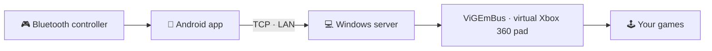

<div align="center">

# Bluetooth receptor on LAN

**Turn any Android phone into a low-latency wireless gamepad receiver for your Windows PC.**

[](https://github.com/RobiiAragon/Bluetooth-receptor-onLAN/actions/workflows/ci.yml)     

**English** · [Español](README.es.md)

</div>

---

No Bluetooth on your PC? Pair your controller with your phone instead. The Android app captures the gamepad and streams **only its input state** over your local network; the Windows server turns it into a virtual **Xbox 360 controller** (XInput) through ViGEm, so every game sees a normal pad.



## Features

- ⚡ Low-latency TCP stream with keepalive.
- 🔎 Automatic discovery or manual `IP:port`.
- 🔋 Runs in the background as a foreground service with a tiny overlay; optional battery / Wi-Fi performance hints.
- 🪟 Windows tray app with a log window.
- 🛟 Fail-safe: if the phone goes quiet for 8 s (Wi-Fi drop, phone asleep) the server releases every button and stick, so nothing stays held in-game.

## Requirements

- Android 7.0+ (tested on Android 10–15) and a Bluetooth gamepad paired to it (Xbox One tested)
- Windows 10/11 with the [ViGEmBus driver](https://vigembusdriver.com/)
- Both devices on the same network · TCP port **39500** (and UDP **39501** for automatic discovery) allowed in Windows Firewall

## Build

```powershell
git clone https://github.com/RobiiAragon/Bluetooth-receptor-onLAN.git
cd Bluetooth-receptor-onLAN
./build-pc.ps1            # Windows server → ./publishWin
./build-android.ps1       # Android APK (uses the Gradle wrapper)
./build-android-adb.ps1   # build and install over adb
```

Requires the [.NET 8 SDK](https://dotnet.microsoft.com/download) and the Android SDK (Android Studio installs it) with JDK 17.

No toolchain? Every CI run publishes a debug **APK** and the **Windows server .exe** as downloadable artifacts (Actions → latest run → Artifacts).

### Tests

```sh
dotnet test pc-server.Tests                    # wire protocol (runs on any OS)
cd android-app && ./gradlew testDebugUnitTest  # button mapping
```

## Usage

1. Install ViGEmBus and run the PC server (default port `39500`).
2. Open the Android app, pick your PC (or type its IP) and connect.
3. Press buttons — Windows now shows an Xbox 360 controller.

## Project structure

```
android-app/   Kotlin client: input capture, overlay, foreground service
pc-server/     .NET 8 tray app: TCP server + ViGEm virtual controller (Protocol.cs = wire format)
pc-server.Tests/ xUnit tests for the protocol
build-*.ps1    build scripts
```

## License

[MIT](LICENSE)

---

Made by **[Jesús Aragón](https://github.com/RobiiAragon)** · [Portfolio](https://robiiaragon.github.io/portfolio/)
